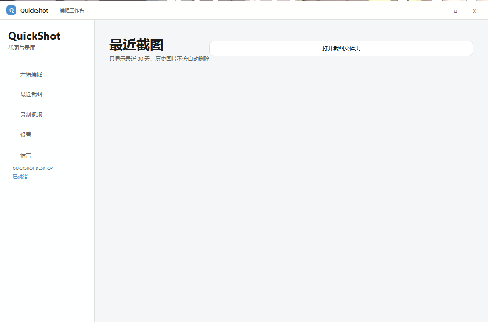
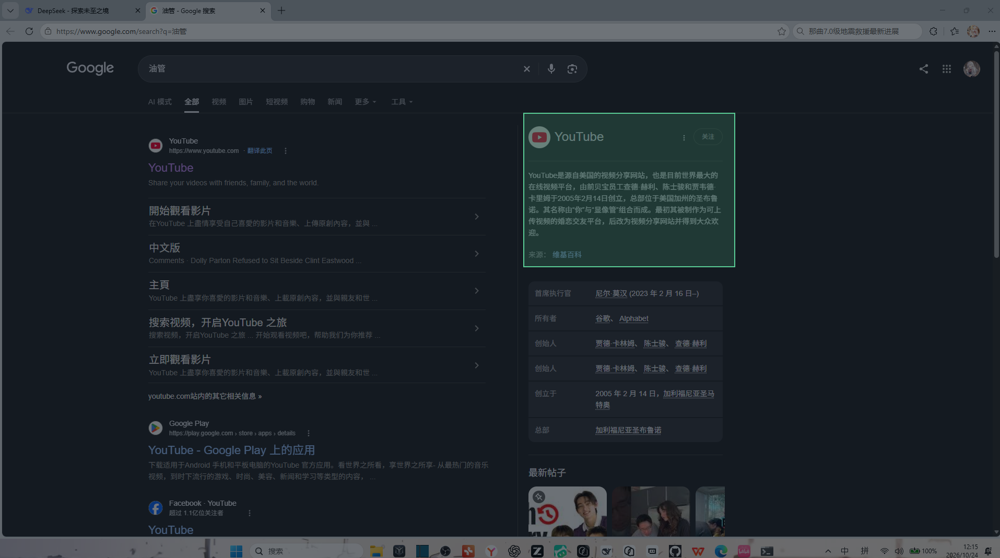
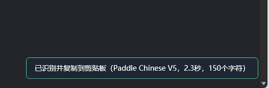
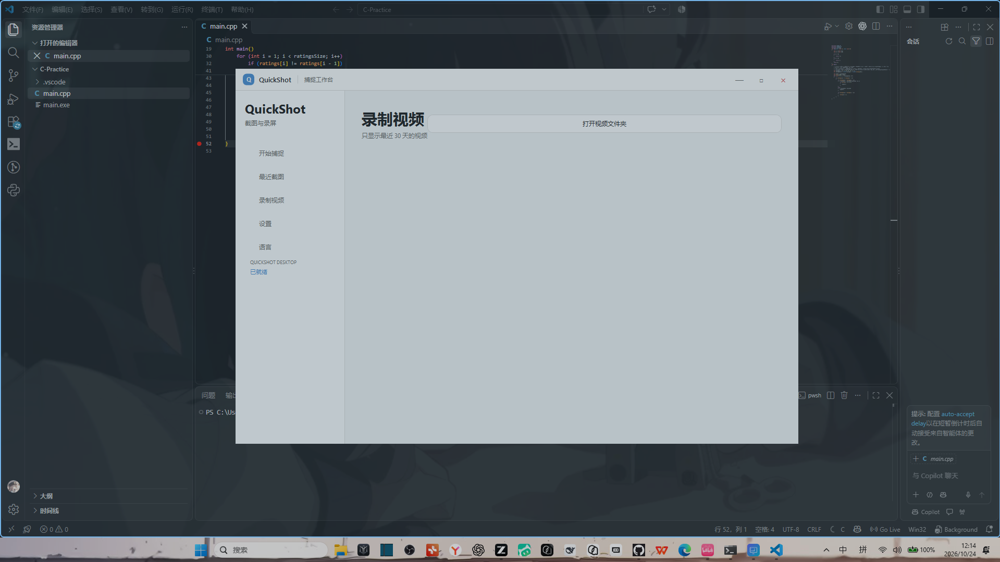
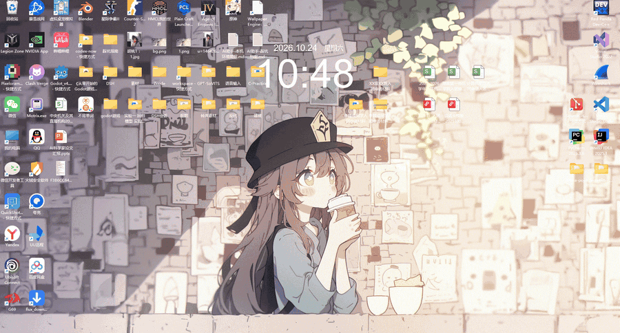

# QuickShot

一款 Windows 开源截图工具：区域截图 / GIF 录制 / 视频录制 / 离线 OCR / 图片分类，支持自定义背景与亚克力磨砂界面。

## 效果演示

| 主界面 | 框选截图 |
|:---:|:---:|
|  |  |

| 离线 OCR | 视频录制 |
|:---:|:---:|
|  |  |

OCR 提示条示例：PaddleOCR 中文 V5 模型本地推理，2.3 秒识别 150 个字符，结果自动复制到剪贴板。

### 操作演示

本 GIF 由 QuickShot 自身的 GIF 录制功能生成（热键停止模式），录制过程中的界面操作不受影响。

## 功能特性

- **区域截图**：全局热键呼出，框选即截，支持自定义背景与界面磨砂效果
- **GIF / 视频录制**：框选区域录制 GIF 动图或带声音的屏幕视频；GIF 支持点击停止与热键停止两种模式（热键模式下录制中可正常操作其他软件）
- **离线 OCR**：内置 PaddleOCR 与 Tesseract 双引擎，本地推理、完全离线，识别结果一键复制
- **图片分类管理**：截图自动归类整理，支持重命名等管理操作
- **界面**：中英文双语切换、深浅色主题、WPF 亚克力（Acrylic）磨砂效果

## 下载使用

1. 进入 [Releases 页面](../../releases) 下载最新发行版压缩包
2. 系统要求：Windows 10（1903+）/ Windows 11，x64
3. 解压后直接运行，**无需安装 .NET 运行时**（自包含发布）

## 技术栈

| 模块 | 技术 |
|---|---|
| 框架 | C# / .NET 8（WPF + WinForms） |
| OCR | Sdcb.PaddleOCR 3.3（含本地 V5 模型）+ Tesseract 5.2 双引擎 |
| 录制 | ScreenRecorderLib（屏幕录制）+ NAudio（音频采集） |
| 图像处理 | OpenCvSharp 4 |
| 系统集成 | CsWinRT（Windows Runtime API 互操作） |

## 实现要点

- **双 OCR 引擎**：PaddleOCR 与 Tesseract 均为本地模型推理，不依赖任何在线接口，断网可用
- **录制链路**：ScreenRecorderLib 捕获屏幕画面 + NAudio 采集系统音频，输出视频 / GIF
- **零依赖分发**：.NET 8 SelfContained 自包含发布，用户机器无需预装运行时
- 第三方组件与许可见 [THIRD-PARTY-NOTICES.txt](THIRD-PARTY-NOTICES.txt)

## 从源码构建

- Visual Studio 2022（.NET 桌面开发工作负载）或 .NET 8 SDK
- 需要 Windows 10 SDK（10.0.22621.0，CsWinRT 引用其 Windows.winmd）
- 构建前确认 `third-party/` 目录中的 ScreenRecorderLib、NAudio 本地 DLL 存在，随后还原 NuGet 包并编译

## License

- 本项目自有代码采用 [GPL-3.0](LICENSE) 许可
- 随包分发的第三方组件版权归各自作者所有，详见 [THIRD-PARTY-NOTICES.txt](THIRD-PARTY-NOTICES.txt)
